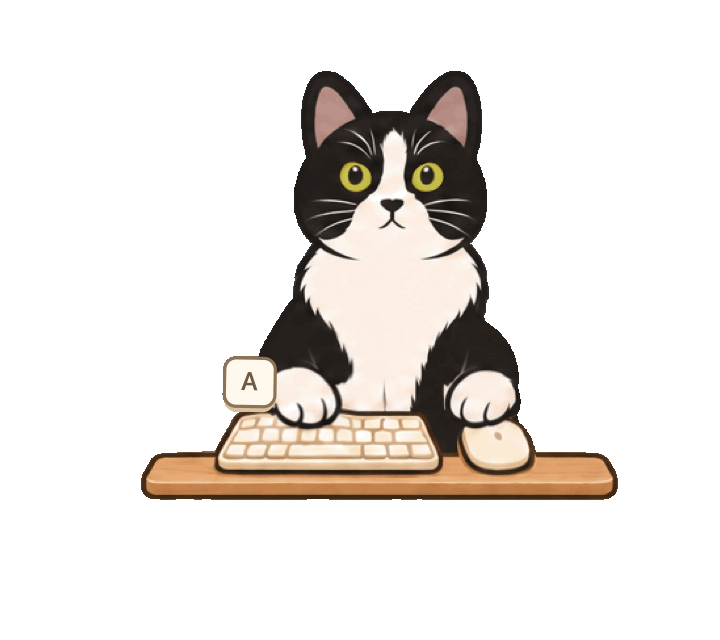
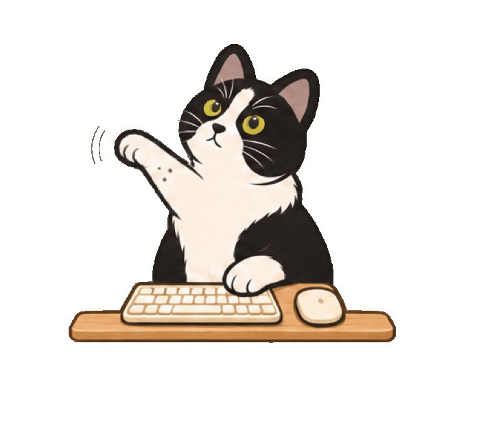
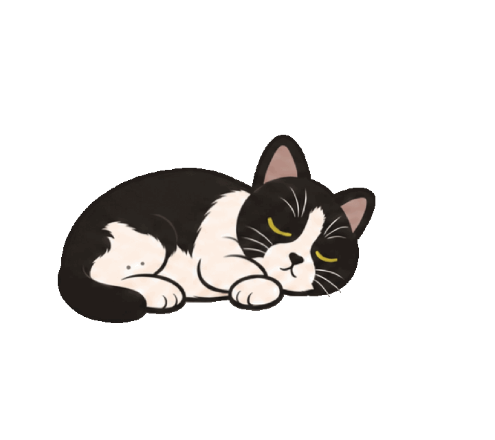
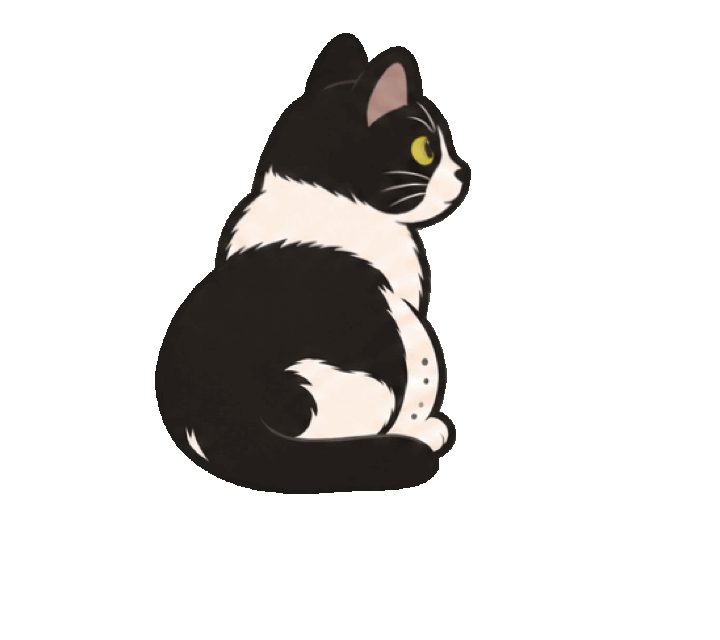
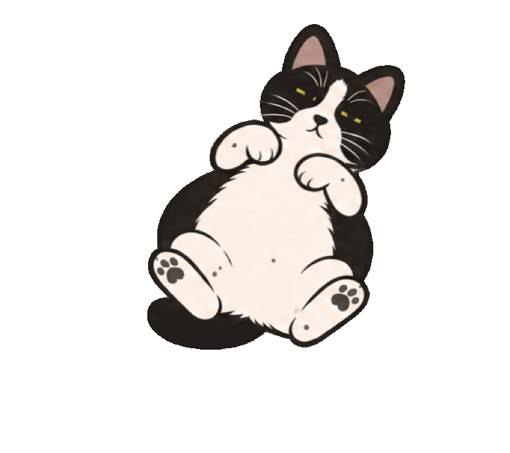
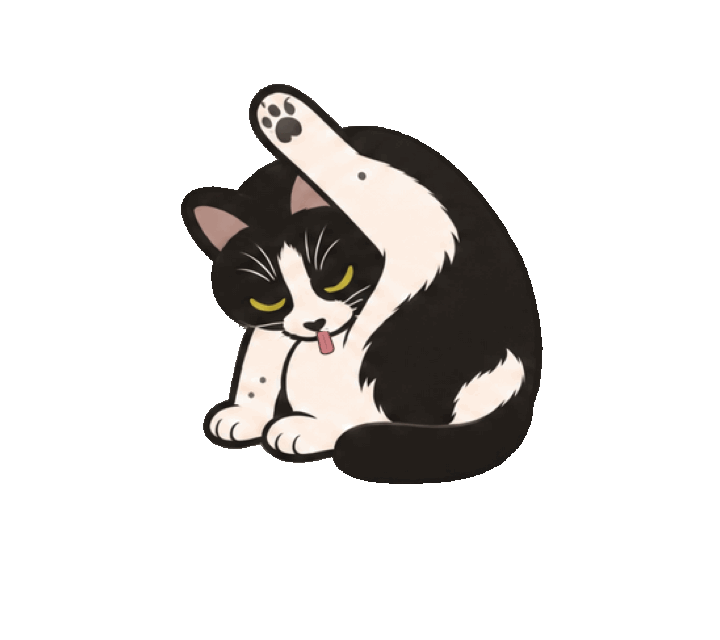

# KuroCat · 黑白猫桌宠

以黑白猫素材制作的 macOS 桌宠：透明背景、原木桌面、键盘气泡、鼠标爪和眼动跟随。

基于 [chanke17/KuroCat](https://github.com/chanke17/KuroCat) 修改，保留原项目的 MIT 许可证。本仓库的定制改动集中在 macOS；Windows 和 Linux 源码保留上游实现，界面与动作不完全相同。[上游使用说明](README.upstream.md)。

## 全部动作展示

| 桌面互动：键盘气泡、鼠标爪与眼动 | 桌边招呼 |
| :---: | :---: |
|  |  |

| 桌垫小睡 | 窗沿发呆 |
| :---: | :---: |
|  |  |

| 露肚抱爪 | 抬腿洗脸 |
| :---: | :---: |
|  |  |

五个专属动作可从右键菜单的“专属动作”中选择，也会在闲置时自动播放。每个动作使用独立的六秒循环：招呼的手臂和手腕分开摆动并配有动作线，小睡时单耳约 0.2 秒快速折回，露肚时对称眯眼轻晃，梳洗时从嘴中央伸舌，观察时轻轻回头。新的按键或鼠标点击会恢复桌面互动。

移动部件独立绘制，避免手臂动作拉动脸部；睁眼姿态保留鼠标眼动跟随。

## 功能

- 全局键盘输入驱动猫爪和按键气泡，支持字母、数字、标点、修饰键、方向键、功能键及数字键盘。
- 气泡显示物理键标签；中文输入法下显示按下的键，而非最终组成的汉字。
- 鼠标爪随指针移动，点击时按压；眼睛跟随指针，猫的身体保持固定。
- 五种专属动作：小睡、招呼、观察、露肚抱爪、抬腿洗脸。新的按键或点击恢复打字互动。
- 透明区域鼠标穿透；支持拖动、尺寸调整、隐藏/显示、闲置动作及开机启动。
- 使用 AppKit 原生右键和菜单栏菜单，支持多显示器及不同缩放比例。

## 编译与运行

需要 macOS 13 或更新版本，以及 Xcode Command Line Tools。

~~~sh
xcode-select --install
bash build.sh
open KuroCat.app
~~~

构建结果为 KuroCat.app，同时包含 Apple Silicon 和 Intel 架构。建议将应用放到 /Applications 后使用。

首次运行，在 **系统设置 → 隐私与安全性 → 输入监控** 中添加并开启实际运行的 KuroCat.app，按系统提示退出并重新打开。菜单栏的小猫图标可查看监听状态。

没有 Apple Development 证书时，构建脚本使用临时签名；重新构建后，macOS 可能要求移除旧授权项、重新添加当前应用并重启。

## 操作

- 右键猫咪或点击菜单栏小猫图标打开选项。
- 拖动猫咪调整位置；菜单中可重置位置或切换尺寸。
- 开启完全鼠标穿透后，按住 ⌥ Option 临时右键或拖动。
- 在“专属动作”中预览姿态，或开启闲置自动播放。

## 验证

~~~sh
bash scripts/check-idle.sh
bash scripts/check-desk-cat.sh
bash scripts/check-custom-cat.sh
bash scripts/check-skins.sh
bash scripts/check-eye-closure.sh
bash scripts/check-ui.sh
~~~

check-ui.sh 会临时显示测试窗口和原生菜单，用于核对菜单命中、窗口位置、尺寸与多屏行为。请在本地桌面会话中运行。

使用当前素材重新导出专属动作动图：

~~~sh
bash scripts/render-actions.sh
~~~

## 目录

- Sources/：macOS 应用、全局输入和渲染逻辑。
- Resources/CustomCat/：运行所需的透明猫咪素材。
- tests/、scripts/：输入、素材和交互回归测试。
- windows/、linux/：保留的上游平台实现。

## 许可证

[MIT](LICENSE)，保留上游版权声明。定制猫咪素材由本项目使用参考照片制作。
